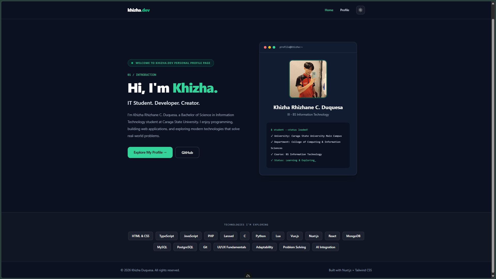
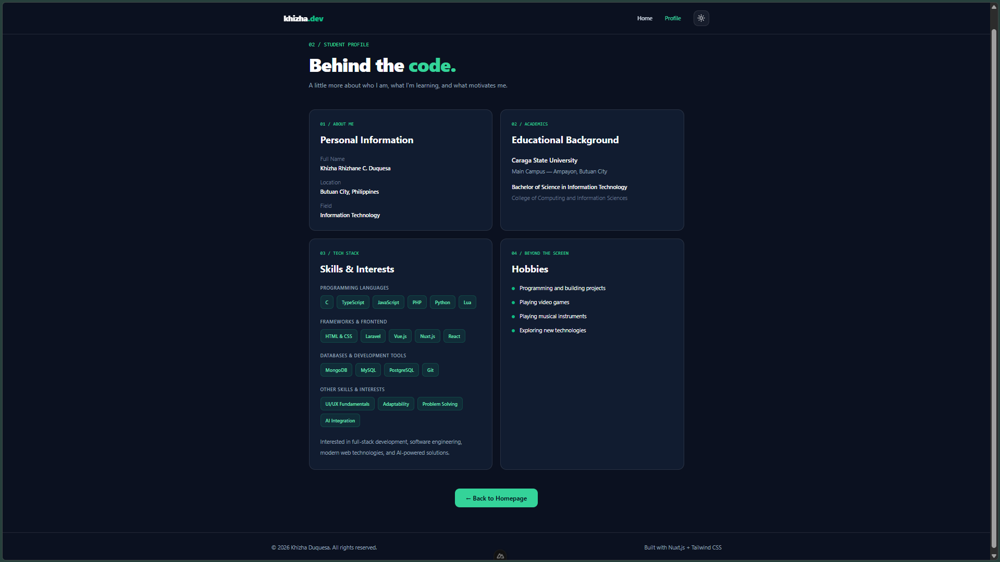
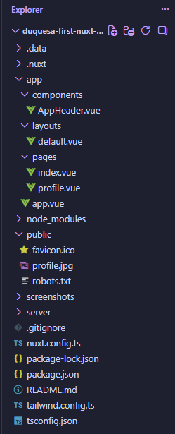

# My First Nuxt Application

**ITE 18 – Activity 1: Frontend Development**

A responsive two-page personal profile website developed using Nuxt.js, Vue.js, and Tailwind CSS.

## Features

- Personal homepage with introduction and profile picture
- Profile page with personal information and educational background
- Skills, interests, and hobbies
- Navigation between Home and Profile
- Dark and light mode toggle
- Responsive design for desktop and mobile devices

## Technologies Used

- Nuxt.js 4
- Vue.js 3
- TypeScript
- Tailwind CSS
- Lucide Icons

## Project Structure

- `app/pages/` – Homepage and profile page
- `app/components/` – Reusable navigation component
- `app/layouts/` – Shared website layout
- `public/` – Profile image and static assets

## Application Screenshots

The following screenshots demonstrate the completed two-page personal profile application built with Nuxt.js and Tailwind CSS.

### 1. Homepage



The homepage displays my introduction, profile picture, navigation menu, and technologies.

### 2. Personal Profile Page



The profile page presents my personal information, educational background, technical skills, interests, and hobbies.

### 3. Project Folder Structure



The project follows the required Nuxt directory structure, including `app/pages`, `app/components`, `app/layouts`, and `public`.

## How to Run

Install dependencies:

```bash
npm install
```

Start the development server:

```bash
npm run dev
```

Open http://localhost:3000 in your browser.

## Developer

**Khizha Rhizhane C. Duquesa**

Bachelor of Science in Information Technology

Caraga State University – Main Campus
